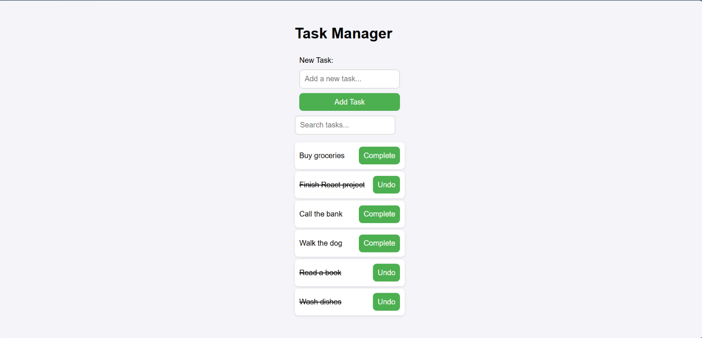

# Task Manager

A React application that lets users add tasks, mark them as completed, and search their task list. Task data is saved through a local backend in `db.json`.

## Features

- Load saved tasks from the backend.
- Add tasks using a form.
- Prevent empty or whitespace-only tasks.
- Mark tasks as complete or undo completion.
- Display completed tasks with a line through the title.
- Search tasks as you type, regardless of capitalization.
- Preserve added tasks and completion changes after refreshing.

## Technologies

- React
- JavaScript and JSX
- Vite
- Context API
- Fetch API
- Vitest and React Testing Library

## React Hooks Used

- `useContext`: Access shared tasks and task functions.
- `useState`: Manage tasks, form input, and search text.
- `useEffect`: Load tasks when the provider mounts.
- `useRef`: Reference the search input and read its current value.
- `useId`: Generate a unique ID linking the task input to its label.

The backend assigns task IDs. `useId` provides the form's accessibility ID.

## Setup and Installation

Clone your fork and open the project folder:

```bash
git clone git@github.com:ashleylopez8976/react-hooks-task-manager-lab.git
cd react-hooks-task-manager-lab
npm install
```

Start the frontend:

```bash
npm run dev
```

In a separate terminal, start the backend:

```bash
npm run server
```

Keep both terminals running. Open the local URL provided by Vite.

The application accesses tasks at:

```text
http://localhost:6001/tasks
```

## Usage

1. Enter a task in the New Task field and click Add Task.
2. Click Complete to mark a task as finished.
3. Click Undo to mark it as incomplete.
4. Type in the search field to filter tasks.
5. Clear the search field to display all tasks.

## Testing

Run the tests in watch mode:

```bash
npm run test
```

Run the full test suite once:

```bash
npm run test -- --run
```

The tests check loading, adding, searching, and completing tasks.

All 8 tests passed across 2 test files. Both files run the same four test cases.

Browser checks also confirmed that tasks and completion changes persist after refreshing.

## Screenshot



## Project Structure

```text
src/
├── __tests__/
│   ├── test_suites/
│   │   └── Hooks.test.jsx
│   ├── App.test.jsx
│   └── setup.jsx
├── components/
│   ├── App.jsx
│   ├── SearchBar.jsx
│   ├── TaskForm.jsx
│   └── TaskList.jsx
├── context/
│   └── TaskContext.jsx
├── index.css
└── main.jsx
```

## Author

Ashley Lopez